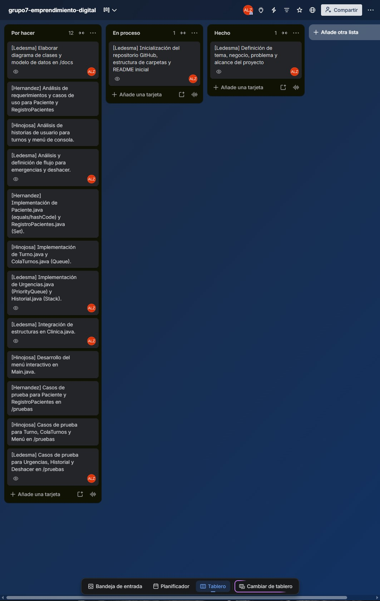
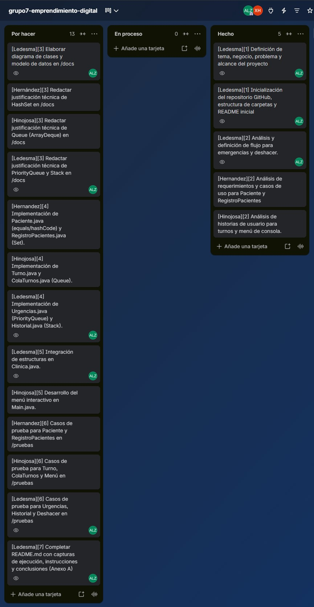
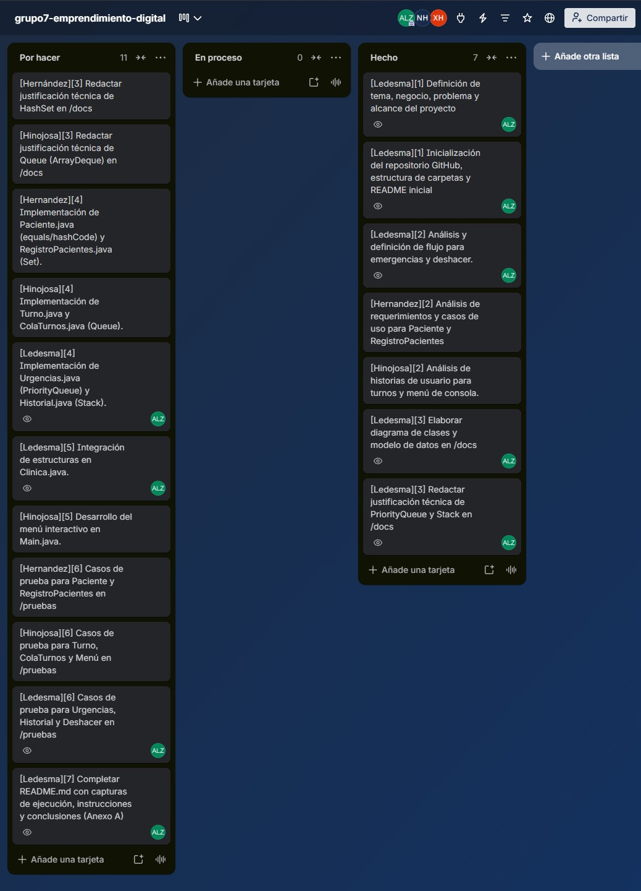
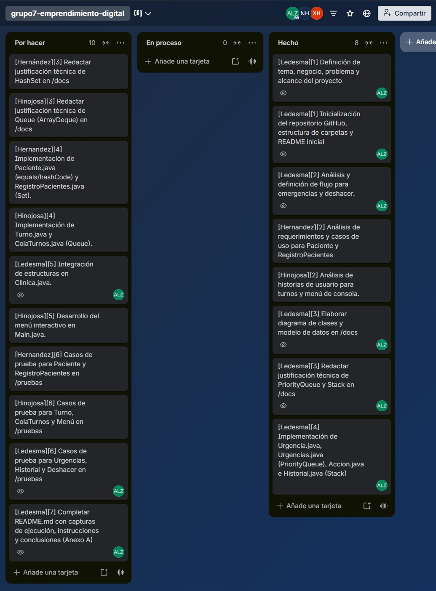
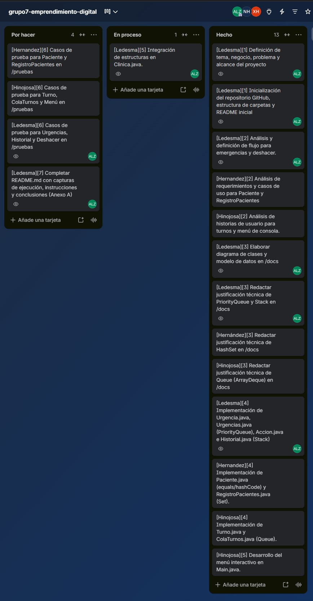
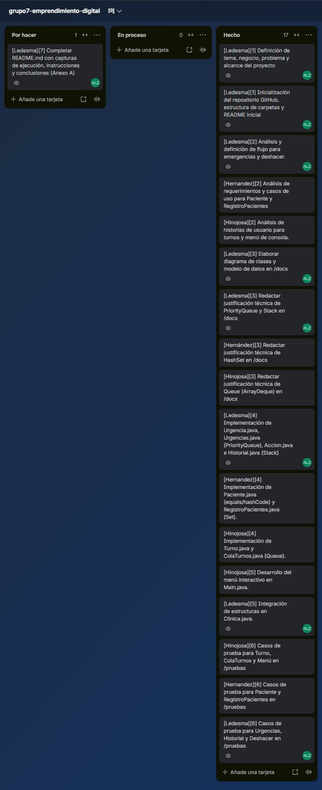
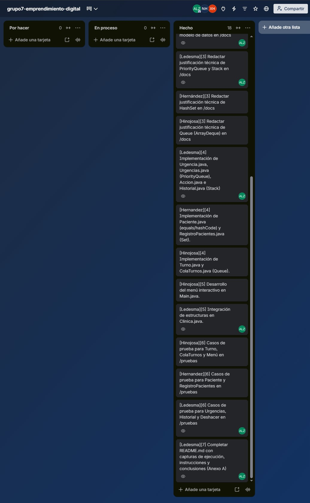

# Bitácora de Desarrollo - Grupo 7

## Día 1 (09/11/2026)
- **Qué hicimos:** Definición del negocio (Clínica médica), alcance y contrato de métodos. Alta del repositorio en GitHub, armado del tablero Trello y vinculación de enlaces en la planilla de la cátedra.
- **Quién hizo qué:**
  - Ledesma: Creación del repositorio, estructura de carpetas, README inicial y alta del tablero Kanban.
- **Qué nos trabó:** Ninguna dificultad en el alta del proyecto.
- **Qué sigue:** Día 2 - Redacción de casos de uso e historias de usuario en `/docs/analisis.md`.
- **Captura del tablero:** `kanban/dia-1.jpg`

## Día 2 (10/11/2026)
- **Qué hicimos:** Creación y redacción del documento de análisis y requerimientos en `/docs/analisis.md`. Especificamos el problema del negocio, requerimientos funcionales e historias de usuario por módulo.
- **Quién hizo qué:**
  - Ledesma: Creación de la estructura del documento de análisis, ademas de redactar y colocar la problemática general, especificación técnica de las entidades: Urgencias (PriorityQueue) e Historial (Stack), y también las historias de usuario HU-04, HU-05 y HU-06.
  - Hernández: Redacción del requerimiento funcional RF-01, correspondiente al registro y validación de pacientes mediante DNI. Elaboración de las historias de usuario HU-01 y HU-02 para el registro y búsqueda de pacientes. Actualización del documento /docs/analisis.md.
  - Hinojosa: Especificación del requerimiento funcional RF-02: turnos de consulta regular, utilizando la estructura Queue con criterio FIFO. Redacción de las historias de usuario HU-03 y HU-07 y actualización del documento `/docs/analisis.md` en GitHub  
- **Qué nos trabó:** Ninguna.
- **Qué sigue:** Día 3 - Crear los diagramas de clases, modelos de datos y justificación técnica de estructuras en `/docs`.
- **Captura del tablero:** `kanban/dia-2.jpg`

## Día 3 (11/11/2026)
- **Qué hicimos:** Elaboración del diagrama de clases del sistema y redacción del documento de justificación técnica y de negocio de las estructuras de datos seleccionadas en `/docs/justificacion.md`.
- **Quién hizo qué:**
  - Ledesma: Diseño y exportación del diagrama de clases (`diagrama-clases-mejorado.png`), creación de la estructura de `justificacion.md` y fundamentación técnica de `PriorityQueue` y `Stack` (ArrayDeque).
  - Hernández: Redacción de la justificación técnica y de negocio de la estructura HashSet para el padrón único de pacientes en /docs/justificacion.md. Fundamentación de la elección de esta estructura y explicación de la importancia de los métodos equals() y hashCode() utilizando el DNI como identificador único.
  - Hinojosa: Redacción de la justificación técnica de Queue (ArrayDeque) para la gestión de turnos mediante el principio   FIFO, en /docs/justificacion.md.
    Desarrollo de las clases ColaTurnos.java y turnos.java.
- **Qué nos trabó:** -
- **Qué sigue:** Día 4 - Desarrollo I: Creación de las clases base y la primera mitad del código en `/src` (modelos y estructuras individuales).
- **Captura del tablero:** `kanban/dia-3.jpg`

## Día 4 (12/11/2026)
- **Qué hicimos:** Creación de la primera parte del codigo en `/src`, las entides en `modelo` y luego las estructuras que van a almacenar esos modelos en `estructuras`.
- **Quién hizo qué:**
  - Ledesma: Implementación del modelo `Urgencia.java` (junto a su estructura `Urgencias.java`) y de las estructuras `Accion.java` y `Historial.java`.
  - Hernández:
  - Hinojosa: 
- **Qué nos trabó:** Creación de las clases sin haber definido todos los tipos (Paciente, Turno, etc).
- **Qué sigue:** Día 5 - Desarrollo II: Segunda mitad del código en `/src` (modelos y estructuras individuales).
- **Captura del tablero:** `kanban/dia-4.jpg`

## Día 5 (13/11/2026)
- **Qué hicimos:** Se completó el menú interactivo en `Main.java` y se crearon todos los metodos de la fachada `Clinica.java`, todos esos metodos son usados por `Main.java`, y ademas Clinica se encarga de llamar a los métodos propios de cada estructura para cada acción de la fachada.
- **Quién hizo qué:**
  - Ledesma: Creación de la fachada `Clinica.java`, con todos los metodos que debe exponer al `Main.java`.
  - Hernández:
  - Hinojosa: 
- **Qué nos trabó:** Coordinar el menú con cada método de la fachada.
- **Qué sigue:** Día 6 - Pruebas y ajustes: Tarjetas de pruebas y correcciones.
- **Captura del tablero:** `kanban/dia-5.jpg`

## Día 6 (14/11/2026)
- **Qué hicimos:** Integración final de los módulos, pruebas integrales y completas del sistema en consola verificando las cuatro estructuras de datos (`HashSet`, `Queue`, `PriorityQueue` y `Stack`), registro de los casos de prueba en `/pruebas/casos-de-prueba.md` y actualización del `README.md` completo.
- **Quién hizo qué:**
  - Ledesma: Ejecución y documentación de los casos de prueba de guardia por prioridad (`Urgencias`) e historial de deshacer (`Historial`/`Accion`), y ajuste de detalles finales de integración.
  - Hernández: 
  - Hinojosa: 
- **Qué nos trabó:** Verificar los casos borde al deshacer acciones (como intentar cancelar un turno o una urgencia que ya habían sido atendidos) para asegurar que el sistema informe la situación correctamente sin alterar el estado.
- **Qué sigue:** Día 7 - Cierre del proyecto, verificación de todas las tarjetas en la columna "Hecho" del tablero Kanban y preparación para la defensa oral.
- **Captura del tablero:** `kanban/dia-6.jpg`

## Día 7 (15/11/2026)
- **Qué hicimos:** Cierre del proyecto integrador. Carga de capturas en el README, revisión general, etc.
- **Quién hizo qué:**
  - Ledesma: Revisión final del repositorio, documentación en `README.md` y repaso de la defensa técnica sobre fachada, `PriorityQueue` y `Stack`.
  - Hernández: Verificación de documentación, pruebas y repaso de la defensa técnica sobre `HashSet` e igualdad por DNI (`equals`/`hashCode`).
  - Hinojosa: Actualización final del tablero Kanban, verificación del menú principal y repaso de la defensa técnica sobre `Queue` (`ArrayDeque`).
- **Qué nos trabó:** Ninguna dificultad; el sistema compila y supera todos los casos de prueba planteados.
- **Qué sigue:** Presentación y defensa oral del proyecto en la semana del 16/11.
- **Captura del tablero:** `kanban/dia-7.jpg`

